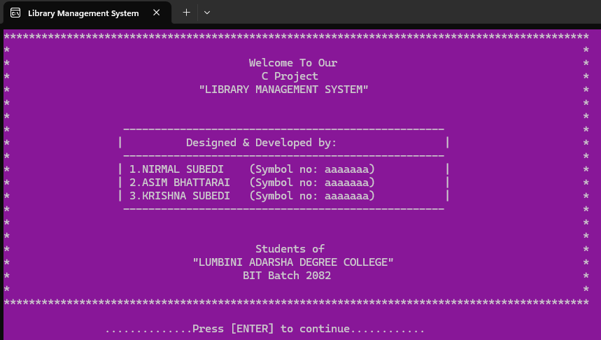
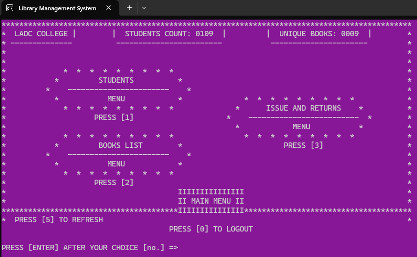
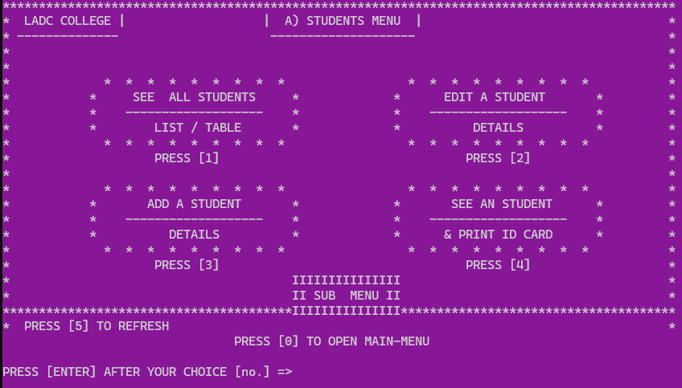
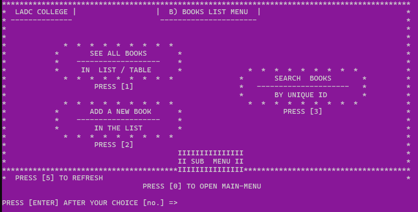
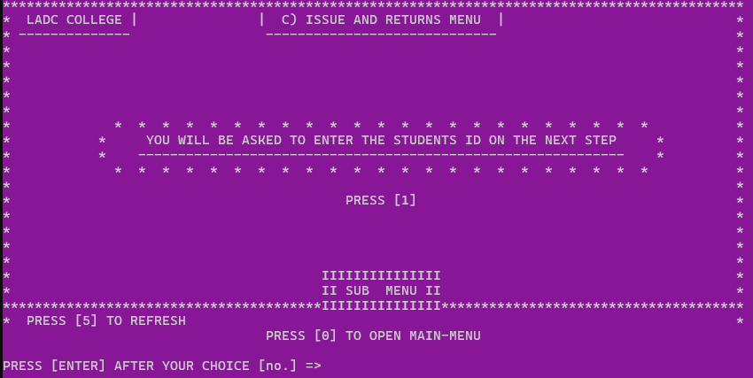

# 📚 Library Management System (C)


A console-based Library Management System built in C, developed as a college project for Purbanchal University (BIT — Project I, BIT106CO).

## Authors

- Krishna Subedi
- Nirmal Subedi
- Asim Bhattarai

**Institution:** Lumbini Adarsha Degree College, Kawasoti, Nawalpur
**Supervisor:** Mr. Suraj Bhattarai

## Overview

This system manages student records, book inventory (with individual copy-level tracking), and the book issue/return process — all through a menu-driven console interface with persistent file-based storage.

## Features

- 🔐 **Secure login system** with password masking and attempt tracking
- 🧭 **Multi-level menu navigation** using a call-stack pattern (Intro → Login → Main Menu → Sub-menus)
- 🎓 **Student management** — auto-generated student IDs, add/edit/view records, ID card printing
- 📖 **Book management** — auto-generated book IDs, per-copy tracking (each physical copy tracked individually with status: AVAILABLE/ISSUED)
- 🔄 **Issue/return system** — search by student ID, copy-level issue tracking with issue date
- 💾 **Persistent storage** using pipe-delimited `.txt` files — no external database required
- ✨ Animated console feedback for a smoother user experience

## Tech Stack

- **Language:** C
- **Compiler/IDE:** Dev-C++ (TDM-GCC)
- **Libraries:** `stdio.h`, `stdlib.h`, `string.h`, `conio.h`, `windows.h`, `time.h`
- **Storage:** Pipe-delimited text files (`student.txt`, per-book files like `bk_XXX.txt`, `copy.txt`)

## How to Run

1. Clone or download this repository
2. Open the `.c` file in Dev-C++
3. Compile and run (or via terminal):

```
gcc library_management_system_ladc_2082.c
library_management_system_ladc_2082.exe

```

4. Data files are either created automatically on first run or auto generated as we input new records.

## Screenshots

intro_page() - Welcome Page
  
unlocked_menu_page() - Main Menu
 
menu_1_student_menu()
  
menu_2_book_list_menu()
  
menu_3_issue_return_menu()
  

## Project Structure

```
├── library_management_system_ladc_2082.c
├── data file in text format
├── Every_Segments_Screenshot/
├── Project_walk_through_Drafts/
└── README.md
```

## Known Limitations

- Single-user, single-terminal (no networking/multi-user support)
- Windows-only (uses `conio.h` and `windows.h`)
- No automatic fine calculation or due-date reminders
- Text-file storage (no indexing or query optimization)

## License

All rights reserved (academic use). See [LICENSE](LICENSE) for details.

---

**Academic project — please do not submit as your own work. This is our original project work. Thank you.**
